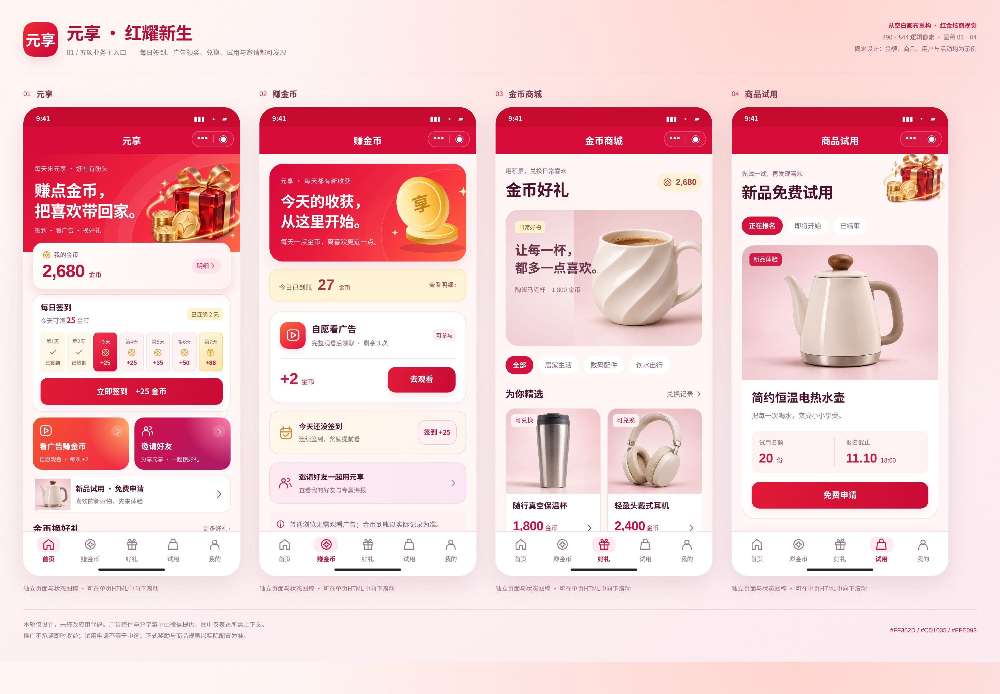

# 元享 · 红耀新生

## 全新红色UI：48个界面与关键状态

本轮从空白画布重新设计，只围绕五项核心业务：**签到赚金币、看广告赚金币、金币兑换商品、商品试用、推广好友**。采用鲜明红色舞台、立体金色奖励、商品摄影和全新页面构图。

**这是独立设计分支，未修改上一版应用源码，尚未进入本轮开发。**

- [下载48页完整PDF图册](yuanxiang-red-48-screens.pdf)
- [核心四屏高清总览](board-images/01.jpg)
- [48屏逐页索引及旧路由归并](screen-map.md)
- [全新红金视觉概念](assets/concept.png)

## 完整12组总览

|组|流程|包含界面|总览|
|---|---|---|---|
| 01 | 五项业务主入口 | 01 元享、02 赚金币、03 金币商城、04 商品试用 | [查看高清总览](board-images/01.jpg) |
| 02 | 签到与每日习惯 | 05 每日签到、06 签到成功、07 签到记录、08 签到提醒 | [查看高清总览](board-images/02.jpg) |
| 03 | 广告领奖完整流程 | 09 广告奖励、10 原生广告播放、11 奖励到账、12 观看未完成 | [查看高清总览](board-images/03.jpg) |
| 04 | 金币账户与明细 | 13 我的金币、14 金币明细、15 金币收入、16 金币支出 | [查看高清总览](board-images/04.jpg) |
| 05 | 商品兑换完整流程 | 17 好礼详情、18 确认兑换、19 兑换结果、20 金币还差一点 | [查看高清总览](board-images/05.jpg) |
| 06 | 订单与物流信息 | 21 兑换记录、22 订单详情、23 订单详情、24 物流信息 | [查看高清总览](board-images/06.jpg) |
| 07 | 试用申请完整流程 | 25 试用详情、26 确认试用申请、27 申请成功、28 我的试用 | [查看高清总览](board-images/07.jpg) |
| 08 | 试用结果与资料提交 | 29 试用申请进度、30 试用中选结果、31 试用结果、32 资料提交成功 | [查看高清总览](board-images/08.jpg) |
| 09 | 邀请好友与专属海报 | 33 邀请好友、34 专属邀请海报、35 分享给好友、36 我的好友 | [查看高清总览](board-images/09.jpg) |
| 10 | 我的账户与帮助 | 37 我的、38 个人资料、39 设置、40 帮助与规则 | [查看高清总览](board-images/10.jpg) |
| 11 | 收货地址完整流程 | 41 收货地址、42 编辑收货地址、43 选择地址、44 添加收货地址 | [查看高清总览](board-images/11.jpg) |
| 12 | 冷却缺货与异常恢复 | 45 加载失败、46 兑换记录、47 广告奖励冷却中、48 商品已售罄 | [查看高清总览](board-images/12.jpg) |

## 每一张界面

|编号|界面|高清图|可滚动HTML|
|---|---|---|---|
|01|元享|[查看](images/01.jpg)|[源图稿](pages/01.html)|
|02|赚金币|[查看](images/02.jpg)|[源图稿](pages/02.html)|
|03|金币商城|[查看](images/03.jpg)|[源图稿](pages/03.html)|
|04|商品试用|[查看](images/04.jpg)|[源图稿](pages/04.html)|
|05|每日签到|[查看](images/05.jpg)|[源图稿](pages/05.html)|
|06|签到成功|[查看](images/06.jpg)|[源图稿](pages/06.html)|
|07|签到记录|[查看](images/07.jpg)|[源图稿](pages/07.html)|
|08|签到提醒|[查看](images/08.jpg)|[源图稿](pages/08.html)|
|09|广告奖励|[查看](images/09.jpg)|[源图稿](pages/09.html)|
|10|原生广告播放|[查看](images/10.jpg)|[源图稿](pages/10.html)|
|11|奖励到账|[查看](images/11.jpg)|[源图稿](pages/11.html)|
|12|观看未完成|[查看](images/12.jpg)|[源图稿](pages/12.html)|
|13|我的金币|[查看](images/13.jpg)|[源图稿](pages/13.html)|
|14|金币明细|[查看](images/14.jpg)|[源图稿](pages/14.html)|
|15|金币收入|[查看](images/15.jpg)|[源图稿](pages/15.html)|
|16|金币支出|[查看](images/16.jpg)|[源图稿](pages/16.html)|
|17|好礼详情|[查看](images/17.jpg)|[源图稿](pages/17.html)|
|18|确认兑换|[查看](images/18.jpg)|[源图稿](pages/18.html)|
|19|兑换结果|[查看](images/19.jpg)|[源图稿](pages/19.html)|
|20|金币还差一点|[查看](images/20.jpg)|[源图稿](pages/20.html)|
|21|兑换记录|[查看](images/21.jpg)|[源图稿](pages/21.html)|
|22|订单详情|[查看](images/22.jpg)|[源图稿](pages/22.html)|
|23|订单详情|[查看](images/23.jpg)|[源图稿](pages/23.html)|
|24|物流信息|[查看](images/24.jpg)|[源图稿](pages/24.html)|
|25|试用详情|[查看](images/25.jpg)|[源图稿](pages/25.html)|
|26|确认试用申请|[查看](images/26.jpg)|[源图稿](pages/26.html)|
|27|申请成功|[查看](images/27.jpg)|[源图稿](pages/27.html)|
|28|我的试用|[查看](images/28.jpg)|[源图稿](pages/28.html)|
|29|试用申请进度|[查看](images/29.jpg)|[源图稿](pages/29.html)|
|30|试用中选结果|[查看](images/30.jpg)|[源图稿](pages/30.html)|
|31|试用结果|[查看](images/31.jpg)|[源图稿](pages/31.html)|
|32|资料提交成功|[查看](images/32.jpg)|[源图稿](pages/32.html)|
|33|邀请好友|[查看](images/33.jpg)|[源图稿](pages/33.html)|
|34|专属邀请海报|[查看](images/34.jpg)|[源图稿](pages/34.html)|
|35|分享给好友|[查看](images/35.jpg)|[源图稿](pages/35.html)|
|36|我的好友|[查看](images/36.jpg)|[源图稿](pages/36.html)|
|37|我的|[查看](images/37.jpg)|[源图稿](pages/37.html)|
|38|个人资料|[查看](images/38.jpg)|[源图稿](pages/38.html)|
|39|设置|[查看](images/39.jpg)|[源图稿](pages/39.html)|
|40|帮助与规则|[查看](images/40.jpg)|[源图稿](pages/40.html)|
|41|收货地址|[查看](images/41.jpg)|[源图稿](pages/41.html)|
|42|编辑收货地址|[查看](images/42.jpg)|[源图稿](pages/42.html)|
|43|选择地址|[查看](images/43.jpg)|[源图稿](pages/43.html)|
|44|添加收货地址|[查看](images/44.jpg)|[源图稿](pages/44.html)|
|45|加载失败|[查看](images/45.jpg)|[源图稿](pages/45.html)|
|46|兑换记录|[查看](images/46.jpg)|[源图稿](pages/46.html)|
|47|广告奖励冷却中|[查看](images/47.jpg)|[源图稿](pages/47.html)|
|48|商品已售罄|[查看](images/48.jpg)|[源图稿](pages/48.html)|

## 本地查看

下载整个分支ZIP并解压，双击 `index.html` 可滚动查看48个手机图稿；每个手机内部也可向下滚动。`pages/` 是单页HTML，`images/` 是48张高清JPG，`board-images/` 是12张总览，PDF每页一个界面，共48页。

GitHub网页不会直接运行HTML；请在本地解压后打开，或直接查看JPG/PDF。

## 设计边界

- 金额、商品、活动日期、收货地址和用户均为设计示例。商品图片为新生成的无品牌摄影式设计素材，未冒充真实上架商品。
- 试用申请成功不等于中选；邀请不承诺立即金币或现金奖励。
- 广告播放页与微信分享引导仅表达平台容器的上下文，不伪造SDK播放控制或好友选择器。
- 金币可用于商品兑换，本轮不增加现金提现、创作、阅读、门店优惠或多级推广收益。
- 48张图包含关键状态，**不表示必须开发48条独立新路由**。旧48条路由的合并和退场去向见 `screen-map.md`。

## 检查结果

- 48/48编号齐全；12组各4屏。
- PDF共48页，每页一屏。
- 浏览器排版记录全部390逻辑像素宽，无横向溢出。
- 已检查12组总览；修正默认地址标记、签到历史/日期、试用名称及插画与文字层叠。
- 本轮不修改应用，不执行后台、真实广告或订单，也不宣称已通过微信真机运行。

## 复现图稿

`python3 build.py` 生成HTML；在已安装Playwright/Chromium的环境中执行 `python3 render.py` 导出高清图及PDF。字体使用系统中文无衬线字库。所有布局文件均从本轮空白文件建立，未导入旧应用WXML/WXSS。
