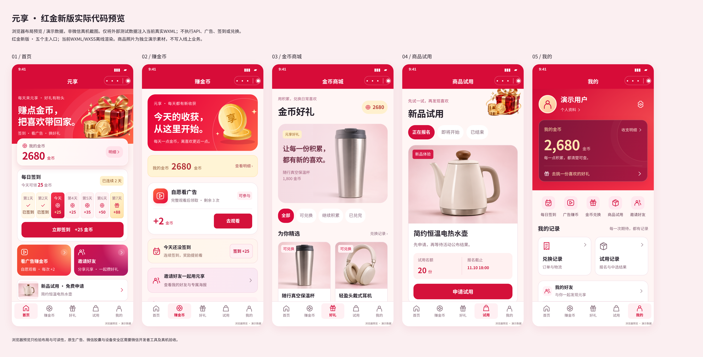

# 元享微信小程序 · 红金新版

按已确认的红金设计重新实现页面布局，核心功能为签到赚金币、自愿看广告赚金币、金币兑换商品、商品试用、邀请好友。五个主入口：首页 / 赚金币 / 好礼 / 试用 / 我的。

## 导入源码

1. 解压后，在微信开发者工具导入同时包含 `app.json` 和 `project.config.json` 的项目根目录。
2. 使用原小程序所属团队账号与现有 AppID；基础库沿用 3.7.1。无需安装 npm 依赖。
3. `siteinfo.js`、原微擎接口与后台配置继续沿用；本包不含后端 PHP。配置真实业务及图片 HTTPS 合法域名后进行联调。
4. 奖励、次数、库存、商品、试用结果及二维码均以真实后台为准。

## 本次实现

- 红色渐变主视觉、金色金币与礼盒插画、独立重排的卡片和五栏导航；统一重建图标及加载、空、错误、冷却、成功状态。
- 签到日历、成功回执与真实签到记录；广告前置说明、原生激励视频、完整观看结算、提前关闭与核验中状态。
- 钱包及收支明细；商品详情、余额不足、库存不足、地址选择、二次确认、兑换回执、订单和真实物流单号。
- 试用申请、申请记录、待公布及实际中选结果、收件信息提交；申请成功不会当作中选。
- 邀请入口、真实专属二维码海报、微信原生分享、好友记录；个人资料、地址、提醒、设置与帮助。
- 已确认的48张设计对应页面或页内状态，映射见 [设计状态覆盖](docs/RED_SCREEN_COVERAGE.md)。现有48个注册路由保留兼容，历史功能不再占据核心入口。
- 保留真实接口和奖励账本校验、提交锁、重复操作保护、失败恢复及未知余额保护。页面不引用演示商品或演示账本。

## 验证与预览

```sh
npm run verify
```

78项离线行为测试全部通过，48/48注册页面模块及368处模板事件检查通过。打包源文件估算为1.915 MiB，最终编译体积以微信开发者工具为准。报告见 [源码检查](scripts/validation-report.json) 与 [行为测试](scripts/test-report.json)。

[14张实际代码布局预览](docs/preview/README.md) 从当前 WXML/WXSS 转换生成，使用隔离的演示数据，不是微信真机截图。五个主入口预览：



## 联调边界

尚未执行微信官方编译、真机、真实业务后台、原生广告播放、订阅送达或真实兑换订单联调。离线测试不能代替这些验证；发布前按 [联调清单](docs/ACCEPTANCE.md) 验收。本次只交付独立分支源码，未发布小程序或修改线上数据。

收货地址沿用按账户保存在当前设备的机制。设计工具、测试、文档及演示照片通过 `project.config.json` 排除出小程序代码包。
