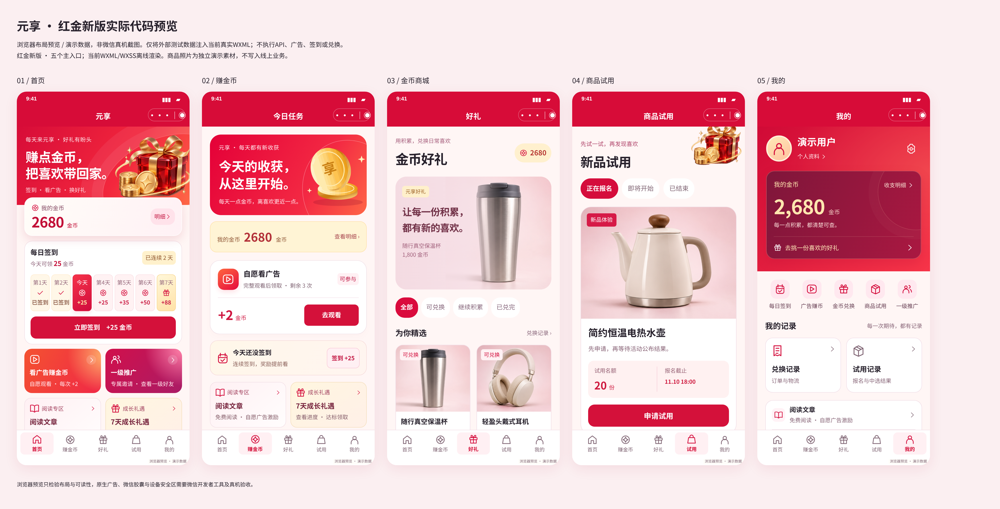

# 红金版核心页面预览

当前WXML/WXSS的浏览器转换预览，使用独立演示数据；不是微信真机截图，没有执行真实接口、签到、广告或兑换。正式页面使用后台实际数据。

- [首页](home.png)
- [赚金币](tasks.png)
- [金币商城](gifts.png)
- [商品试用](trial.png)
- [我的](mine.png)
- [每日签到](sign.png)
- [商品详情](product.png)
- [邀请好友](invite.png)
- [广告奖励](offer.png)
- [奖励到账](paid.png)
- [观看未完成](unpaid.png)
- [广告奖励冷却中](cool.png)
- [签到成功](sign-success.png)
- [兑换确认](redeem-confirm.png)

14个状态在390px宽检查无页面横向溢出，表达式警告为0。

阅读、成长、一级推广、说明及相关入口的12个补充状态见 [benefits/README.md](benefits/README.md)。
