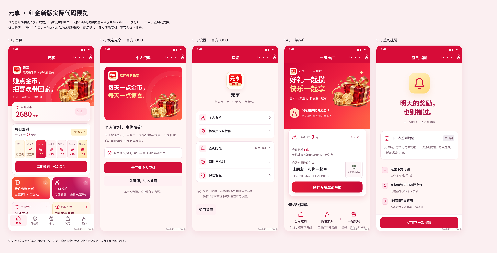

# 品牌LOGO与故障修复预览

当前WXML/WXSS浏览器布局预览，使用隔离演示数据，不是微信真机截图。

- [首页](home.png)
- [欢迎元享 · 官方LOGO](auth.png)
- [设置 · 官方LOGO](settings.png)
- [一级推广](invite.png)
- [签到提醒](reminder.png)
- [已授权 · 待登记](reminder-pending.png)
- [今日已订阅](reminder-confirmed.png)

[邀请海报绘图预览](poster-canvas.png)执行实际海报renderer，使用标注的演示码，不能用于真实邀请。绘图报告记录真实LOGO和礼盒的根路径；浏览器Canvas适配不代表微信原生验证。

7个品牌及提醒状态在390px检查无页面横向溢出，表达式警告为0。
